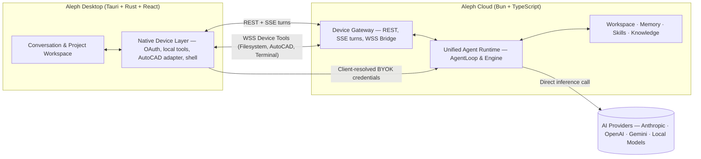

<!--
  Aleph Technologies — Official GitHub Organization Profile
  Repository: alephhq-tech/.github
  Profile source: profile/README.md
-->

  

    

  <h1>Aleph Technologies</h1>

  
<strong>One desktop. Any model. Real work.</strong>

  

    <em>A Model-Agnostic AI Workspace for Real Work Across Desktop Applications</em>
  

  

    <a href="https://alephhq.tech"><strong>Website</strong></a>
    &nbsp;·&nbsp;
    <a href="mailto:contact@alephhq.tech"><strong>Contact</strong></a>
    &nbsp;·&nbsp;
    <a href="https://github.com/alephhq-tech/aleph-platform"><strong>Aleph Platform</strong></a>
    &nbsp;·&nbsp;
    <a href="https://github.com/alephhq-tech?tab=repositories"><strong>Repositories</strong></a>
  

---

## Executive Summary

**Aleph Desktop** is a cross-platform, model-agnostic AI workspace designed to bridge the gap between conversational AI and real-world task execution.

Most AI assistants primarily operate through conversations, generating instructions that users must manually translate into actions. Aleph Desktop moves beyond this limitation by providing a unified environment where AI agents can understand user intent, access authorized context, interact with connected tools, execute multi-step workflows, and deliver observable, verifiable results.

Instead of fragmenting work across multiple AI applications, model providers, automation scripts, and software interfaces, Aleph Desktop brings these capabilities together within one cohesive native workspace.

> **"Artificial intelligence should not stop at generating answers. It should help people complete meaningful work within the digital environments they already use."**

---

## Core Principles

Aleph Desktop is engineered around five fundamental principles:

1. **Model Independence (Model-Agnostic):** Work seamlessly with diverse AI model providers (Anthropic, OpenAI, Gemini), compatible inference APIs, and local or self-hosted models through a single consistent interface.
2. **Context-Aware Intelligence:** Allow AI agents to navigate local project files, folder structures, technical documents, and authorized application state without excessive inference overhead.
3. **Real-World Execution:** Connect AI agents directly to local files, development tools, external APIs, and professional desktop applications via native adapters and open protocols.
4. **Transparent & Verifiable Actions:** Provide clear visibility into agent reasoning, tool invocations, execution progress, error handling, and evidence-based verification of completed tasks.
5. **User Control & Privacy (BYOK):** Strict permission controls, human-in-the-loop oversight for consequential operations, and a client-owned credential model (Bring Your Own Key) where credentials are never hosted or stored server-side.

---

## Architecture Overview

Aleph uses a **hybrid execution model** separating desktop-native capabilities from centralized cloud agent orchestration:

| Layer | Responsibility |
| :--- | :--- |
| **Aleph Desktop** | Cross-platform native application (Tauri, Rust, React, TypeScript). Handles the conversation UI, file attachments, local device node, OS permissions, and direct application bridges. |
| **Aleph Cloud** | Centralized agent runtime providing durable execution, multi-step orchestration, memory persistence, skills management, and model routing. |
| **Open Connectivity (MCP)** | Standardized capability interfaces via Model Context Protocol (MCP) and bidirectional WebSocket device gateways for extensible tool execution. |
| **Client-Owned Security** | Strict BYOK credential resolution on the client device. No server-hosted keys or default model lock-in. |

---

## Technical Validation: Professional Software Automation

A primary research and development focus of Aleph Desktop is **deep professional software automation**. Unlike generic text generation, professional workflows depend on structured documents, domain-specific object models, and strict geometric/technical constraints.

We are actively validating this architecture through a deep integration with **AutoCAD**:
- **Structured Data Inspection:** Extracting layers, blocks, coordinates, dimensions, and entity metadata directly through native application APIs.
- **Multimodal Interpretation:** Connecting visual drawing observations with underlying CAD vector data.
- **Constrained Execution:** Translating natural-language intent into typed, safe application operations.
- **Evidence-Based Verification:** Inspecting execution results and confirming post-operation drawing state against stated requirements.

This technical validation serves as a blueprint for extending agent execution across other CAD, BIM, and engineering design software.

---

## Key Repositories

| Repository | Description | Visibility |
| :--- | :--- | :--- |
| [`aleph-platform`](https://github.com/alephhq-tech/aleph-platform) | The monorepo containing Aleph Desktop (Tauri + React) and Aleph Cloud (Bun + TypeScript). | Private |
| [`aleph-landing-page`](https://github.com/alephhq-tech/aleph-landing-page) | Official marketing and product landing page for Aleph Desktop. | Private |
| [`aleph-docs`](https://github.com/alephhq-tech/aleph-docs) | Official documentation portal and developer guides. | Private |
| [`aleph-omp-bridge`](https://github.com/alephhq-tech/aleph-omp-bridge) | MCP bridge connecting AI assistants to coding environments with isolated workspaces. | Private |
| [`.github`](https://github.com/alephhq-tech/.github) | Organization profile, brand assets, and community health files. | Public |

---

## Development Stage & Collaboration

Aleph is in **active product development and technical validation** (November 2026).

We are seeking international research and development partnerships, cloud computing credits, AI inference resources, and pilot collaborations with engineering teams and technical organizations.

### Contact

**Aleph Technologies**  
- **Website:** [https://alephhq.tech](https://alephhq.tech)  
- **General Inquiries:** [contact@alephhq.tech](mailto:contact@alephhq.tech)  
- **Lead / Contact:** Louis Vo ([louis.vo@alephhq.tech](mailto:louis.vo@alephhq.tech))  
- **Country:** Vietnam  

---

  © 2026 Aleph Technologies. All rights reserved.

